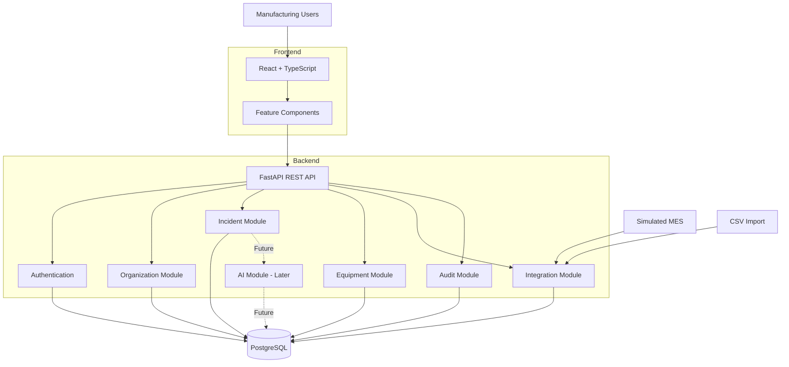

# Industrial Operations Copilot — System Architecture

**Document type:** Architecture Design  
**Version:** 1.0  
**Status:** Initial design  
**Architecture style:** Modular Monolith  
**Last updated:** November 2026

---

## 1. Overview

Industrial Operations Copilot is a multi-tenant SaaS platform designed to centralize industrial operational information, manage production incidents, integrate external manufacturing systems, and provide AI-assisted decision support.

The system follows a modular monolithic architecture using React, FastAPI and PostgreSQL.

The architecture prioritizes:

- Maintainability and separation of responsibilities.
- Secure multi-tenant data management.
- Reliable industrial data integration.
- Testability and observability.
- Responsible AI integration.
- Incremental scalability without premature complexity.

## 2. Architectural Style

### 2.1 Modular Monolith

The backend will be implemented as a single FastAPI application divided into independent functional modules.

Each module will have clearly defined responsibilities.

Initial modules:

| Module | Responsibility |
|---|---|
| Authentication | User authentication and identity |
| Organizations | Organization and membership management |
| Sites | Manufacturing site management |
| Equipment | Machine and equipment management |
| Incidents | Operational incident lifecycle |
| Integrations | External system communication |
| Audit | Application activity tracking |
| AI | Incident analysis and recommendations (later milestone) |

Modules will communicate through application services and well-defined interfaces.

We will avoid introducing microservices unless future requirements justify independent deployment or scaling.

## 3. High-Level Architecture



## 4. Technology Architecture

### 4.1 Frontend

**Technologies:** React, TypeScript and Tailwind CSS.

Responsibilities:

- Present operational information.
- Manage user interactions.
- Communicate with the backend REST API.
- Display incidents and equipment information.
- Provide authentication interfaces.
- Display AI recommendations when introduced.

The frontend will be organized by business features rather than by individual page alone.

### 4.2 Backend

**Technologies:** Python, FastAPI and Pydantic.

Responsibilities:

- Expose REST endpoints.
- Validate incoming requests.
- Authenticate users.
- Enforce authorization.
- Execute business rules.
- Coordinate database operations.
- Process external industrial events.
- Record audit information.

The backend will follow a layered architecture:

```text
HTTP Request
     |
     v
API Router
     |
     v
Request Validation
     |
     v
Application Service
     |
     v
Database Access
     |
     v
PostgreSQL
```

Business logic must not be implemented directly inside API route handlers.

### 4.3 Database

**Technology:** PostgreSQL.

PostgreSQL will be the primary persistence layer.

Responsibilities:

- Store organizations and users.
- Store manufacturing sites and equipment.
- Store incidents and operational events.
- Store integration configurations.
- Store audit records.
- Support future document retrieval capabilities.

Database interaction will use SQLAlchemy.

Alembic will manage database schema migrations.

## 5. Backend Internal Structure

The initial backend structure:

```text
backend/
│
├── app/
│   ├── api/
│   │   └── v1/
│   │       ├── endpoints/
│   │       └── router.py
│   │
│   ├── core/
│   │   ├── config.py
│   │   ├── security.py
│   │   └── database.py
│   │
│   ├── models/
│   ├── schemas/
│   ├── services/
│   ├── repositories/
│   ├── integrations/
│   ├── ai/
│   │
│   └── main.py
│
├── alembic/
├── tests/
├── pyproject.toml
└── Dockerfile
```

### Responsibilities

**api/**

HTTP routing, endpoint definitions and request handling.

**core/**

Shared infrastructure, application configuration, database connections and security utilities.

**models/**

SQLAlchemy database models.

**schemas/**

Pydantic request and response schemas.

**services/**

Business logic and application workflows.

**repositories/**

Database access abstractions when useful.

**integrations/**

Adapters for MES, ERP and other external systems.

**ai/**

Future AI orchestration, document retrieval and structured recommendation generation.

## 6. Frontend Internal Structure

```text
frontend/
│
├── src/
│   ├── app/
│   ├── components/
│   ├── features/
│   │   ├── dashboard/
│   │   ├── incidents/
│   │   ├── equipment/
│   │   ├── integrations/
│   │   └── authentication/
│   │
│   ├── hooks/
│   ├── services/
│   ├── types/
│   ├── utils/
│   └── main.tsx
│
├── package.json
└── Dockerfile
```

Feature modules will contain their own components and feature-specific logic.

Shared components will be placed in `components/`.

HTTP communication will be centralized in `services/`.

## 7. Multi-Tenant Architecture

The platform is designed to support multiple manufacturing organizations.

Each organization represents an independent tenant.

Initial relationship:

```text
Organization
    |
    +---- Memberships
    |        |
    |        +---- Users
    |
    +---- Sites
    |        |
    |        +---- Machines
    |                 |
    |                 +---- Incidents
    |
    +---- Audit Logs
```

### Tenant Isolation Rules

1. Every organization-owned entity must have an `organization_id`, directly or through a validated parent relationship.
2. The authenticated user must have a valid membership in the requested organization.
3. Database queries must be scoped to the active organization.
4. The backend must never trust organization identifiers supplied by the frontend without authorization checks.
5. Cross-tenant access must be covered by automated tests.

PostgreSQL Row-Level Security may be introduced as additional defense in depth.

## 8. Authentication and Authorization

Initial authentication will use email and password.

Passwords will be stored using a secure password hashing algorithm.

The application will implement role-based access control.

Initial roles:

| Role | Permissions |
|---|---|
| Admin | Manage organization members and operational resources |
| Member | Access operational resources and manage permitted incidents |

Authorization will be enforced on the backend.

Frontend permissions are only for user experience and must never be treated as security controls.

## 9. Industrial Data Integration

External manufacturing systems will communicate with the platform through integration adapters.

Initial supported ingestion mechanisms:

- REST API.
- CSV import.
- Simulated MES source.

### Event Processing Flow

```text
External System
      |
      v
Integration Endpoint
      |
      v
Input Validation
      |
      v
Event Normalization
      |
      v
Business Validation
      |
      v
PostgreSQL
      |
      v
Incident Management
```

Integration adapters will translate external data structures into internal application schemas.

This prevents external system formats from spreading throughout the application.

Important considerations:

- Input validation.
- Source identification.
- Event timestamps.
- Duplicate event handling.
- Error handling.
- Logging.
- Tenant ownership.

The initial implementation will use synchronous HTTP ingestion. Background processing can be introduced when workload requirements justify it.

## 10. AI Architecture (Future)

AI functionality will be introduced after the core application is operational.

The AI module will provide decision-support capabilities.

Planned workflow:

```text
Incident
   |
   v
Incident Context Retrieval
   |
   v
Historical Data + Procedures
   |
   v
LLM
   |
   v
Structured Output
   |
   v
Pydantic Validation
   |
   v
Evidence Presentation
   |
   v
Human Review
   |
   v
Audit Log
```

Initial AI technology:

- Ollama.
- DeepSeek R1.
- Python integration.
- Pydantic structured schemas.

### Responsible AI Principles

- AI recommendations are advisory.
- Deterministic validation rules take precedence.
- Recommendations must include supporting evidence where available.
- AI-generated hypotheses must be distinguished from observed facts.
- Human engineers retain final decision authority.
- AI failures must not interrupt incident management.
- Important recommendations and human decisions must be auditable.

The AI module will never directly control industrial equipment.

## 11. Security Architecture

Initial security requirements:

- Secure password hashing.
- Authentication and authorization.
- Organization-level access control.
- Input validation.
- Environment-based secret management.
- Database constraints.
- Audit logging.
- Secure error handling.
- Cross-tenant isolation tests.

Secrets must never be committed to the Git repository.

## 12. Deployment Architecture

The initial development environment will use Docker Compose.

Planned services:

| Container | Responsibility |
|---|---|
| frontend | React development server |
| backend | FastAPI application |
| database | PostgreSQL |

The application will be designed so each component can be built and started independently.

Production deployment will be introduced in a later milestone.

## 13. Testing Strategy

Testing will be introduced incrementally.

### Unit Tests

Validate isolated business logic and utility functions.

### API Integration Tests

Validate HTTP endpoints, request validation and response behavior.

### Database Tests

Validate persistence, relationships and transaction behavior.

### Security Tests

Validate authentication, authorization and tenant isolation.

### Integration Tests

Validate external event ingestion and normalization.

### AI Evaluation Tests (Future)

Validate response structure, evidence grounding and recommendation quality.

## 14. Observability and Reliability

The application should provide enough operational visibility to troubleshoot failures.

Initial requirements:

- Structured application logs.
- Meaningful HTTP error responses.
- Database health checks.
- Integration error logging.
- AI service failure isolation.
- Health and readiness endpoints.

Future improvements may include metrics, distributed tracing and centralized log aggregation.

## 15. Architecture Decisions

| Decision | Rationale |
|---|---|
| Modular monolith | Avoid unnecessary distributed complexity |
| React + TypeScript | Maintainable interactive frontend |
| FastAPI | Typed Python REST API |
| PostgreSQL | Relational persistence and future extensibility |
| SQLAlchemy | Explicit database interaction |
| Alembic | Version-controlled schema changes |
| Docker Compose | Reproducible development environment |
| REST ingestion | Simple initial integration mechanism |
| Local LLM | Controlled AI experimentation |
| Human approval | Operational accountability |

## 16. Future Architectural Evolution

The architecture may evolve as product requirements grow.

Potential additions:

- OPC UA integration.
- MQTT ingestion.
- Background job processing.
- PostgreSQL pgvector.
- Advanced analytics.
- External ERP connectors.
- Enterprise authentication.
- Production monitoring.

Each addition must solve a concrete product or engineering problem.

---

## Conclusion

Industrial Operations Copilot is designed around a simple principle:

**Industrial data must become actionable operational information without sacrificing reliability, security or human control.**

The initial architecture deliberately favors simplicity, clear responsibilities and incremental development.

The objective is to build a maintainable SaaS foundation that can evolve into a production-grade industrial operations platform.