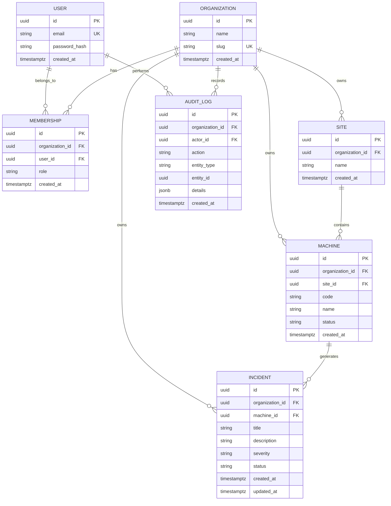

# Database Design

## 1. Overview

The Industrial Operations Copilot uses PostgreSQL as its primary relational database.

The initial schema supports:
- Multi-tenant organizations.
- Users and organization memberships.
- Manufacturing sites and machines.
- Operational incidents.
- Audit logging.

The database is designed around data integrity, tenant isolation, and maintainability.

All primary keys use UUIDs. Timestamps are stored in UTC using PostgreSQL `TIMESTAMPTZ`.

## 2. Entity Relationship Diagram



## 3. Entities

### 3.1 Organization

Represents a customer company or tenant.

| Field | Type | Constraints |
|---|---|---|
| id | UUID | Primary key |
| name | VARCHAR(255) | NOT NULL |
| slug | VARCHAR(100) | UNIQUE, NOT NULL |
| created_at | TIMESTAMPTZ | NOT NULL |

Each organization owns its sites, machines, incidents, memberships, and audit logs.

### 3.2 User

Represents a platform user.

| Field | Type | Constraints |
|---|---|---|
| id | UUID | Primary key |
| email | VARCHAR(255) | UNIQUE, NOT NULL |
| password_hash | VARCHAR(255) | NOT NULL |
| created_at | TIMESTAMPTZ | NOT NULL |

Users are global identities. A user can belong to multiple organizations through memberships.

Email addresses should be normalized to lowercase before storage.

### 3.3 Membership

Connects users to organizations and defines their roles.

| Field | Type | Constraints |
|---|---|---|
| id | UUID | Primary key |
| organization_id | UUID | FK, NOT NULL |
| user_id | UUID | FK, NOT NULL |
| role | VARCHAR(50) | NOT NULL |
| created_at | TIMESTAMPTZ | NOT NULL |

Initial roles:
- `admin`
- `manager`
- `engineer`
- `operator`

A user can have different roles in different organizations.

Constraint:
- UNIQUE (`organization_id`, `user_id`)

### 3.4 Site

Represents a physical manufacturing facility.

| Field | Type | Constraints |
|---|---|---|
| id | UUID | Primary key |
| organization_id | UUID | FK, NOT NULL |
| name | VARCHAR(255) | NOT NULL |
| created_at | TIMESTAMPTZ | NOT NULL |

An organization can own multiple sites.

### 3.5 Machine

Represents an industrial machine or production asset.

| Field | Type | Constraints |
|---|---|---|
| id | UUID | Primary key |
| organization_id | UUID | FK, NOT NULL |
| site_id | UUID | FK, NOT NULL |
| code | VARCHAR(100) | NOT NULL |
| name | VARCHAR(255) | NOT NULL |
| status | VARCHAR(50) | NOT NULL |
| created_at | TIMESTAMPTZ | NOT NULL |

Initial machine statuses:
- `running`
- `stopped`
- `maintenance`
- `offline`

Constraint:
- UNIQUE (`site_id`, `code`)

The machine stores `organization_id` directly to simplify tenant-scoped queries.

To prevent inconsistent ownership, use a composite foreign key:

- (`site_id`, `organization_id`) references Site (`id`, `organization_id`).

This ensures that a machine cannot belong to a site owned by another organization.

The referenced Site columns must have a matching UNIQUE constraint.

### 3.6 Incident

Represents an operational issue requiring investigation or action.

| Field | Type | Constraints |
|---|---|---|
| id | UUID | Primary key |
| organization_id | UUID | FK, NOT NULL |
| machine_id | UUID | FK, NOT NULL |
| title | VARCHAR(255) | NOT NULL |
| description | TEXT | NOT NULL |
| severity | VARCHAR(50) | NOT NULL |
| status | VARCHAR(50) | NOT NULL |
| created_at | TIMESTAMPTZ | NOT NULL |
| updated_at | TIMESTAMPTZ | NOT NULL |

Initial severity values:
- `low`
- `medium`
- `high`
- `critical`

Initial incident statuses:
- `open`
- `investigating`
- `resolved`
- `closed`

Use database constraints to restrict severity and status to supported values.

Like Machine, Incident stores `organization_id` directly.

Use a composite foreign key:

- (`machine_id`, `organization_id`) references Machine (`id`, `organization_id`).

This prevents an incident from referencing a machine belonging to another organization.

### 3.7 AuditLog

Records important user and system actions.

| Field | Type | Constraints |
|---|---|---|
| id | UUID | Primary key |
| organization_id | UUID | FK, NOT NULL |
| actor_id | UUID | FK, NULL |
| action | VARCHAR(100) | NOT NULL |
| entity_type | VARCHAR(100) | NOT NULL |
| entity_id | UUID | NOT NULL |
| details | JSONB | NOT NULL |
| created_at | TIMESTAMPTZ | NOT NULL |

Examples of audited actions:
- `incident.created`
- `incident.updated`
- `incident.status_changed`
- `machine.updated`
- `ai.recommendation.generated`
- `ai.recommendation.reviewed`

`actor_id` is nullable because some actions may be generated by automated system processes.

Audit records should be append-only from the application perspective.

## 4. Relationships and Cardinality

| Relationship | Cardinality |
|---|---|
| Organization → Membership | One-to-many |
| User → Membership | One-to-many |
| Organization → Site | One-to-many |
| Site → Machine | One-to-many |
| Organization → Machine | One-to-many |
| Machine → Incident | One-to-many |
| Organization → Incident | One-to-many |
| Organization → AuditLog | One-to-many |
| User → AuditLog | One-to-many |

A user can belong to multiple organizations. The Membership entity handles this many-to-many relationship.

## 5. Multi-Tenant Isolation

Tenant isolation is a core security requirement.

Every tenant-owned entity includes an `organization_id`:
- Membership
- Site
- Machine
- Incident
- AuditLog

The backend must determine the active organization from the authenticated user's authorized memberships.

The backend must never trust an organization ID supplied by the frontend without validating membership.

Every tenant-scoped query must filter by the active organization.

Example:

```python
statement = select(Incident).where(
    Incident.organization_id == current_organization.id
)
```

Composite foreign keys enforce consistency between related records.

Future improvement:
- PostgreSQL Row-Level Security (RLS) can provide an additional layer of tenant isolation.

## 6. Indexes and Constraints

Recommended initial indexes:

| Table | Index |
|---|---|
| Organization | UNIQUE (`slug`) |
| User | UNIQUE (`email`) |
| Membership | UNIQUE (`organization_id`, `user_id`) |
| Site | (`organization_id`) |
| Machine | (`organization_id`, `site_id`) |
| Machine | UNIQUE (`site_id`, `code`) |
| Incident | (`organization_id`, `status`, `created_at`) |
| Incident | (`organization_id`, `severity`) |
| AuditLog | (`organization_id`, `created_at`) |

Foreign keys should be indexed where needed for query performance.

PostgreSQL does not automatically create indexes on the referencing side of foreign keys.

## 7. Deletion Strategy

Initial deletion rules:

- Organization: restrict deletion while dependent records exist.
- User: restrict deletion while memberships or audit references exist; account deactivation can be added later.
- Membership: may be deleted when a user is removed from an organization.
- Site: restrict deletion while machines exist.
- Machine: restrict deletion while incidents exist.
- Incident: prefer status changes and retention policies over hard deletion.
- AuditLog: do not expose normal application deletion operations.

Use explicit deletion policies rather than cascading deletion of operational history.

## 8. Future Entities

These entities are intentionally excluded from the first database implementation:

| Entity | Purpose |
|---|---|
| Integration | External MES/ERP connection configuration |
| ProductionEvent | Raw events received from industrial systems |
| Document | Procedures and technical documentation |
| DocumentChunk | Text chunks used for retrieval |
| AIAnalysis | Structured AI-generated analysis |
| Notification | Alerts and user notifications |

They will be introduced when the corresponding features are implemented.

## 9. Design Decisions

1. UUID primary keys are used for stable identifiers.
2. Users are global identities and organizations are connected through Membership.
3. Tenant-owned records carry `organization_id` directly.
4. Composite foreign keys prevent cross-tenant references.
5. Timestamps use UTC.
6. Database constraints enforce important integrity rules.
7. Operational history and audit logs are protected from accidental deletion.
8. The initial design favors a modular relational schema over premature distributed architecture.

## 10. Implementation Order

The database implementation will follow this order:

1. Organization and User.
2. Membership.
3. Site.
4. Machine.
5. Incident.
6. AuditLog.
7. Constraints and indexes.
8. Alembic migrations.
9. Automated database tests.

This schema is the initial foundation and may evolve as product requirements become clearer.